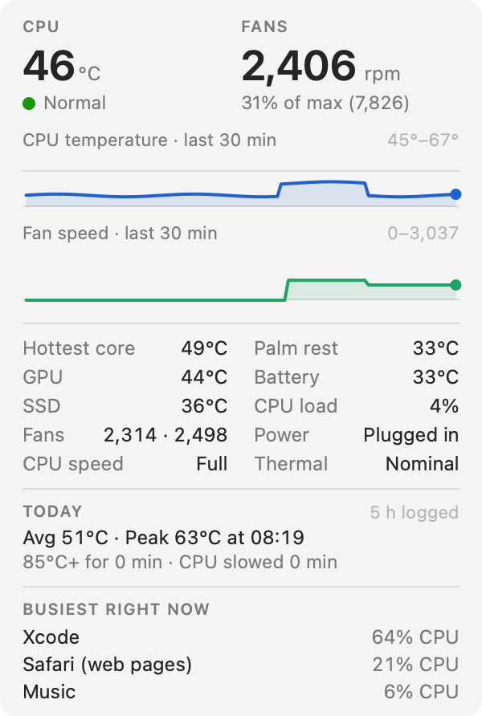
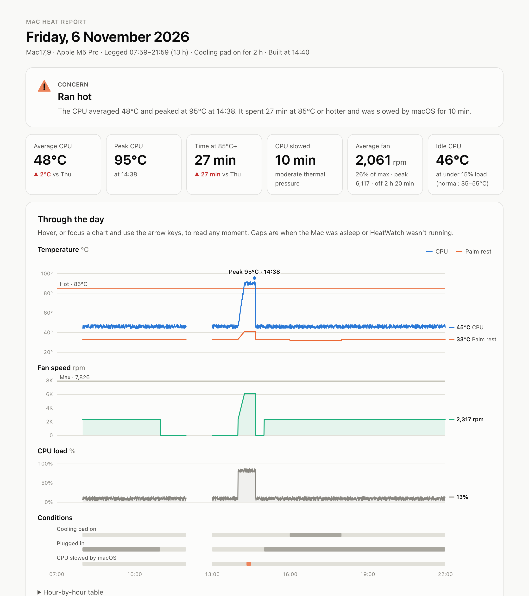

# HeatWatch: Mac CPU temperature and fan monitor for Apple Silicon and Intel

[](https://github.com/hanshika0292/heatwatch/actions/workflows/ci.yml)
[](LICENSE)


**A free, open-source (MIT) menu-bar app that shows your Mac's CPU temperature, fan speed and thermal throttling, then writes a daily heat report.** Works on Apple Silicon Macs (M1, M2, M3, M4 and M5, including Pro, Max and Ultra) and on Intel Macs. No sudo, no kernel extension, no helper tool, no third-party packages, no network access. Install from source with one command.

<p align="center">
  <picture>
    <source media="(prefers-color-scheme: dark)" srcset="docs/panel-dark.png">
    
  </picture>
</p>

macOS doesn't show CPU temperature or fan speed anywhere. HeatWatch puts them in the menu bar, records them all day, and answers the questions you actually have:

- **Is my Mac running too hot?** Live CPU temperature with a Normal / Warm / Hot / Very hot status.
- **Is macOS throttling my CPU?** It detects thermal throttling on Apple Silicon (thermal pressure) and on Intel (the CPU speed cap).
- **Are the fans keeping up?** Speed of every fan, as rpm and as a percentage of maximum.
- **What's making it hot?** The busiest apps while the CPU was hot.
- **Does my cooling pad help?** It compares temperatures with and without the pad at the same CPU load.

## Contents

- [Features](#features) · [Supported Macs](#supported-macs) · [Install](#install) · [The daily heat report](#the-daily-heat-report)
- [What's a normal Mac CPU temperature?](#whats-a-normal-mac-cpu-temperature) · [FAQ](#faq) · [How it works](#how-it-works) · [Limitations](#limitations) · [License](#license)

## Features

**Menu bar.** CPU temperature and fan speed, e.g. `52°  2317 rpm`, or temperature only. The text turns orange when the CPU is hot and red when it's very hot.

**Live panel** (click the menu-bar item):

- CPU temperature and fan speed, with a status, and a note when macOS is slowing the CPU
- 30-minute charts of CPU temperature and fan speed (CPU load on fanless Macs)
- Every sensor: hottest CPU core, GPU, SSD (chipset on Intel), palm rest, battery, each fan, CPU load, power source, CPU speed and macOS thermal state
- Today so far: average and peak temperature, time spent hot, time throttled
- The three busiest apps right now. Helper processes count toward their app, so Chrome's helpers count as Chrome

**Daily heat report.** An interactive HTML page that opens in your browser every evening. [More below](#the-daily-heat-report).

**Cooling-pad tracking.** Tick **Using Cooling Pad** (⌘P) while a laptop cooling pad is running. The report then shows whether it lowers CPU and palm-rest temperature at the same workload.

**Light on resources.** It reads the sensors every 5 seconds (2 or 10 if you prefer). On an M5 Pro one reading takes about 7 ms, almost all of it waiting on the hardware: about 0.6 ms of CPU, roughly 0.01% of one core. The app uses about 24 MB of memory and writes about 200 KB of logs a day.

**Private.** Everything stays on your Mac. HeatWatch makes no network connections and has no analytics. The report is a single self-contained file.

## Supported Macs

macOS 12 Monterey or later. One universal build runs natively on both Apple Silicon and Intel.

| Mac | How CPU temperature is read | Status |
|---|---|---|
| **Apple Silicon M5, M5 Pro, M5 Max** | Average of every CPU sensor (`Tp…` keys) | ✅ Tested on an M5 Pro MacBook Pro (Mac17,9) |
| **Apple Silicon M1, M2, M4** (and Pro, Max, Ultra) | Average of every CPU sensor (`Tp…`/`Te…` keys) | ✅ Supported. Sensor layout from [Stats](https://github.com/exelban/stats)' tables |
| **Apple Silicon M3, M3 Pro, M3 Max, M3 Ultra** | Average of the `Te…`, `Tf0…` and `Tf4…` sensors (M3 uses its own layout) | ✅ Supported. Sensor layout from Stats' tables |
| **Intel MacBook Pro, MacBook Air, iMac, Mac mini, Mac Pro** | CPU package sensor (`TC0P`, `TC0D`, `TCXC`…) | ✅ Tested on a 2017 13-inch MacBook Pro (MacBookPro14,1) |
| **Fanless Macs** (Apple Silicon MacBook Air) | As above | ✅ The panel shows GPU temperature and CPU load in place of the fan |
| **Desktops** (Mac mini, Mac Studio, iMac) | As above | ✅ Battery and palm rest show `--`; their charts are hidden |

HeatWatch finds Apple Silicon sensors by listing the SMC's keys when it starts, so a chip released after this was written will most likely work too. Run `--probe` (below) to see what your Mac reports. If the numbers look wrong, please [open an issue](https://github.com/hanshika0292/heatwatch/issues) with its output.

## Install

You need the Xcode Command Line Tools (`xcode-select --install`). Xcode itself isn't needed.

```bash
git clone https://github.com/hanshika0292/heatwatch.git
cd heatwatch
./install.sh
```

`install.sh` builds the app, copies it to `~/Applications`, starts it, and starts it at every login. It doesn't need sudo. Look for the temperature in your menu bar.

```bash
git pull && ./install.sh   # update to the latest version
./uninstall.sh             # remove the app and login item (your logs and reports are kept)
```

To try it without installing, run `./build.sh` and then `open build/HeatWatch.app`.

**Check what your Mac reports:**

```bash
~/Applications/HeatWatch.app/Contents/MacOS/HeatWatch --probe
```

```
CPU average     47.2°C
Hottest core    48.4°C
GPU             45.4°C
SSD             37.4°C
Battery         34.7°C
Palm rest       33.4°C
Fan 1           2311 rpm (target 2317, range 2317–7826)
Fan 2           2498 rpm (target 2502, range 2317–7826)
CPU load        4%
Thermal pressure nominal
Thermal state   nominal
Power           plugged in

Sensors         Apple M5 Pro (Mac17,9) · 23 CPU sensors, 7 GPU sensors, 2 fans
One reading     7.71 ms
```

## The daily heat report

At 9 PM (or 6–11 PM, or never: your choice under **Settings**), HeatWatch opens the day's report in your browser. If the Mac was asleep then, it opens it the next time you use the Mac. You can also open it any time with **Open Today's Report** (⌘R) or **Past Reports**.

<p align="center">
  
</p>

The report includes:

- **A verdict and key numbers:** average and peak CPU temperature, time hot, time throttled, average fan speed and idle temperature, compared with the previous day
- **Interactive charts** of CPU and palm-rest temperature, fan speed, CPU load, and when the cooling pad, power adapter and throttling were active. Hover or use the arrow keys to read any moment
- **Plain-language findings**, for example: high idle temperature, fans at full speed while the CPU stays hot, a fan that reads as stopped when macOS asks it to spin, throttling, a hot palm rest or battery, and `kernel_task` among the busy processes
- **Cooling-pad effect** over the last 7 days, split into light, moderate and heavy CPU load so the comparison is fair
- **Which apps were running when it got hot**, and a table of hot spells
- An hour-by-hour table and a 7-day summary, in light and dark mode

## What's a normal Mac CPU temperature?

These are the bands HeatWatch uses. You can change them in `Thresholds` in `Sources/Sensors.swift`.

| | Apple Silicon (average of all CPU sensors) | Intel (CPU package) |
|---|---|---|
| Normal at idle (under 15% CPU) | 35–55°C | 40–60°C |
| Warm | 70°C+ | 75°C+ |
| Hot (orange in the menu bar) | 85°C+ | 90°C+ |
| Very hot (red) | 95°C+ | 97°C+ |

**Apple Silicon runs hot by design.** Individual cores can pass 100°C under heavy load, and Apple lets the chip get warm before spinning the fans up. Temperature on its own isn't a problem. What matters is whether macOS has to **throttle** the chip to cool it, which HeatWatch shows as "CPU slowed". On an M5 Pro, 90 seconds with all 15 cores busy took the average from 47°C to 68°C (hottest core 72°C) while the fans stayed at their minimum.

**Intel Macs** are usually rated to about 100°C and slow themselves down to stay under it. On an older Intel Mac, high temperatures at idle, or the fan at full speed with the CPU still at 90°C+, usually mean dried-out thermal paste or dust. The report flags both.

## FAQ

**How do I check the CPU temperature on my Mac?**
macOS has no built-in display for it. Install HeatWatch and the temperature appears in the menu bar. For a one-off reading, run `HeatWatch --probe` in Terminal.

**How do I know if my Mac is thermal throttling?**
On Apple Silicon, HeatWatch reads macOS's thermal pressure level. Anything above *Nominal* (*Moderate*, *Heavy*) means macOS is lowering the chip's power to cool it. On Intel, it reads the CPU speed cap, where anything under 100% means throttling. Either way the panel shows "slowed", and the report adds up how long it lasted.

**Why do my MacBook Pro's fans show 0 rpm or "Off"?**
Apple Silicon MacBook Pros switch their fans off completely when there's little heat to move. That's normal. HeatWatch only warns if a fan reads as stopped while macOS is asking it to spin.

**Does it work on a MacBook Air?**
Yes. Apple Silicon MacBook Airs have no fan, so the panel shows GPU temperature and CPU load in its place. Fanless Macs throttle sooner under sustained load, and the "CPU slowed" figure shows how often.

**Can HeatWatch control fan speed?**
No. HeatWatch only reads sensors. It never writes to the SMC or changes how your Mac cools itself.

**Does it need admin rights, sudo or a privileged helper?**
No. Reading the SMC (the same chip iStat Menus, TG Pro and Stats read) needs no special rights, and the app installs to your own `~/Applications`.

**Will it slow my Mac down or drain the battery?**
No. See [Light on resources](#features): about 0.01% of one core. It only runs `ps` to find busy apps when the CPU is hot or the menu is open.

**Does a laptop cooling pad actually help?**
Tick **Using Cooling Pad** whenever the pad is on. After a few hours with and without it, the report shows the difference in CPU and palm-rest temperature at the same workload.

**Why not just use iStat Menus, TG Pro or Stats?**
They're great. HeatWatch is narrower: it's free, it's about 1,500 lines of Swift you can read in an afternoon, and its focus is the daily report. It tells you how hot your Mac ran, whether it throttled, what caused it, and whether your cooling pad helps.

## How it works

| Reading | Source |
|---|---|
| Temperatures | SMC keys, read through IOKit |
| Fan speed | SMC keys `FNum`, `F0Ac`, `F0Tg`, `F0Mn`, `F0Mx` (and `F1…` for a second fan) |
| Throttling, Apple Silicon | Thermal pressure from `notify_get_state("com.apple.system.thermalpressurelevel")` |
| Throttling, Intel | `IOPMCopyCPUPowerStatus`, key `CPU_Speed_Limit` |
| Thermal state | `ProcessInfo.thermalState` |
| CPU load | `host_statistics(HOST_CPU_LOAD_INFO)` |
| Power source | `IOPSCopyPowerSourcesInfo` |
| Busiest apps | `/bin/ps -Aco pcpu=,comm=`, on a background queue |

**SMC.** The System Management Controller owns the temperature sensors and fans on both Intel and Apple Silicon Macs. `SMC.swift` is a small read-only client: it opens the `AppleSMC` IOKit service and calls it with `IOConnectCallStructMethod`. It decodes the SMC's data types (`flt`, `ui8`/`ui16`/`ui32`, and the `sp`/`fp` fixed-point formats).

**Finding sensors on Apple Silicon.** Sensor keys change with every Apple chip, so HeatWatch reads the key count (`#KEY`), lists every key by index once at launch (about 3,600 on an M5 Pro), and keeps each family that returns a plausible temperature:

- M1, M2, M4, M5 and later: `Tp…`/`Te…` are CPU sensors and `Tg…` is the GPU
- M3 family: `Te…`, `Tf0…` and `Tf4…` are CPU sensors and `Tf1…`/`Tf2…` the GPU
- `TH0x` is the SSD, `TB0T` the battery and `Ts0P` the palm rest

"CPU" is the average of all CPU sensors and "hottest core" is the highest. Each SMC read takes about 0.2 ms on Apple Silicon, so the GPU's dozens of near-identical sensors are thinned to 8 spread across the chip. Fan count and speed range are read once.

**Logging.** Readings are grouped into 30-second windows, and each window becomes one CSV row (averages, plus the window's peak). The report is built from those rows: `Report.swift` loads the day and the six before it, turns them into JSON, and puts it into `Resources/report.html`, which draws everything with plain JavaScript and inline SVG.

**Launch at login** is a per-user LaunchAgent (`~/Library/LaunchAgents/local.heatwatch.plist`). launchd restarts HeatWatch after a crash, but not after you quit it.

### Files

- Logs: `~/Library/Application Support/HeatWatch/logs/YYYY-MM-DD.csv`
- Reports: `~/Library/Application Support/HeatWatch/reports/heat-report-YYYY-MM-DD.html`
- Set `HEATWATCH_DATA_DIR` to use a different folder, e.g. for testing

CSV columns: `time, cpu, cpu_peak, cpu_prox, gpu, chipset, battery, palm_rest, fan, fan_target, fan_min, fan_max, load, speed_limit, thermal_state, on_ac, cooling_pad, top_processes, pressure`. Empty means the Mac doesn't have that sensor. New columns are only ever added at the end, so older logs keep working.

### Command line

```bash
HeatWatch --probe                            # print every sensor once, and how long a reading takes
HeatWatch --report [YYYY-MM-DD] [--no-open]  # build a report (default: today) and open it
HeatWatch --enable-login-item                # write the LaunchAgent that starts HeatWatch at login
```

### Project structure

```
Sources/
  main.swift            Entry point and command-line flags
  AppDelegate.swift     Menu-bar item, menu, settings, sampling timer, report scheduling
  DashboardView.swift   The live panel
  Sensors.swift         Chip detection, sensor discovery, thresholds, thermal pressure, ps sampler
  SMC.swift             Read-only SMC client over IOKit
  DataLog.swift         30-second windows, CSV storage, daily totals
  Report.swift          Builds the HTML report from 7 days of logs
Resources/report.html   Report template: findings and charts in plain JavaScript and SVG
build.sh                Universal (arm64 + x86_64) build with swiftc, signed ad hoc
install.sh              Builds, installs to ~/Applications and registers the LaunchAgent
uninstall.sh            Removes the app and LaunchAgent; keeps your data
```

Built with Swift, AppKit and IOKit. There's no Xcode project, Swift package or dependency.

## Limitations

- Tested on real hardware on an M5 Pro MacBook Pro and a 2017 Intel MacBook Pro. Other Macs use the same code paths, with Apple Silicon sensor layouts taken from [Stats](https://github.com/exelban/stats)' published tables. Reports from other Macs are welcome.
- Apple Silicon thresholds were set on an M5 Pro. Other chips run at similar temperatures, but you can tune `Thresholds` in `Sources/Sensors.swift`.
- No notifications. The menu-bar colour and the daily report are the alerts.
- The cooling-pad setting is manual. HeatWatch can't detect a pad.
- There's no signed or notarized download. Build from source with `./install.sh`, which avoids Gatekeeper warnings because nothing is downloaded as an app.

## Contributing

Bug reports and pull requests are welcome. The most useful thing you can send is the output of `HeatWatch --probe` from a Mac that isn't listed as tested above, especially an M1–M4 chip, a MacBook Air or a desktop. By contributing, you agree that your contribution is licensed under the MIT License.

## Credits

The Apple Silicon sensor key families follow the sensor tables in [Stats](https://github.com/exelban/stats) by Serhiy Mytrovtsiy, used under the MIT License (see [THIRD_PARTY_NOTICES.md](THIRD_PARTY_NOTICES.md)). Those keys were checked on an M5 Pro by loading the CPU cores and watching which sensors rose.

## License

HeatWatch is released under the [MIT License](LICENSE). Copyright (c) 2026 Hanshika Gupta.

You can use, copy, modify and redistribute it, including commercially, as long as you keep the copyright and licence notice. `build.sh` copies `LICENSE` and `THIRD_PARTY_NOTICES.md` into the app bundle (`HeatWatch.app/Contents/Resources/`), so they travel with any copy of the app. The software comes with no warranty.
